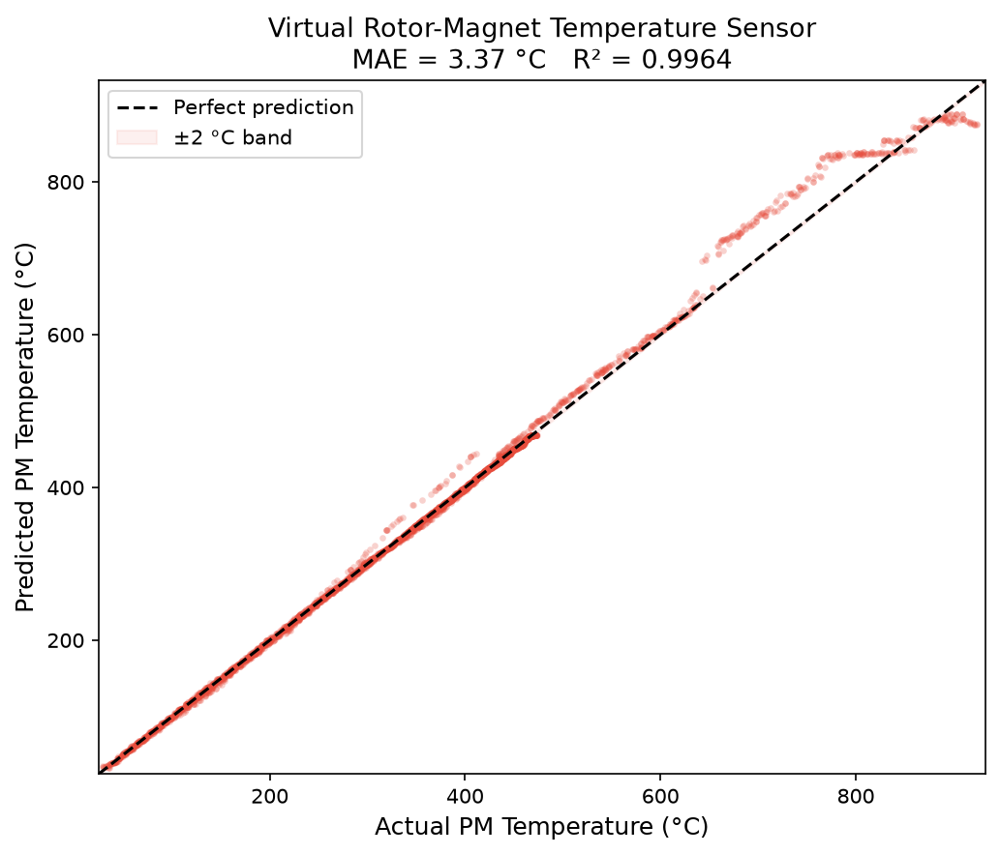
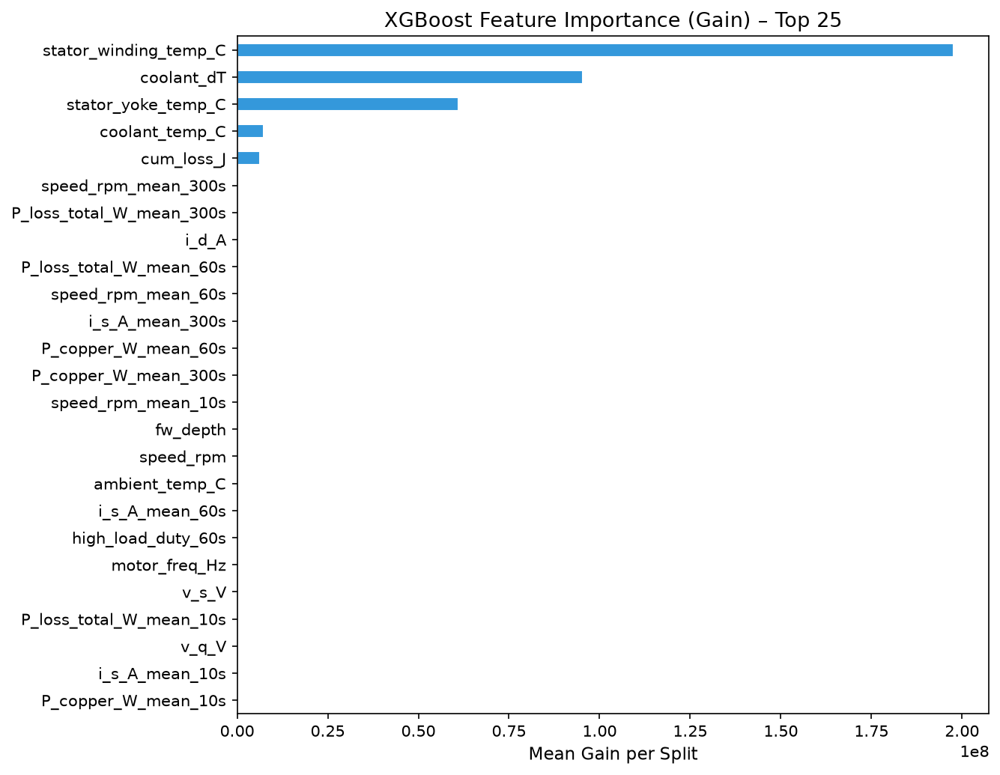
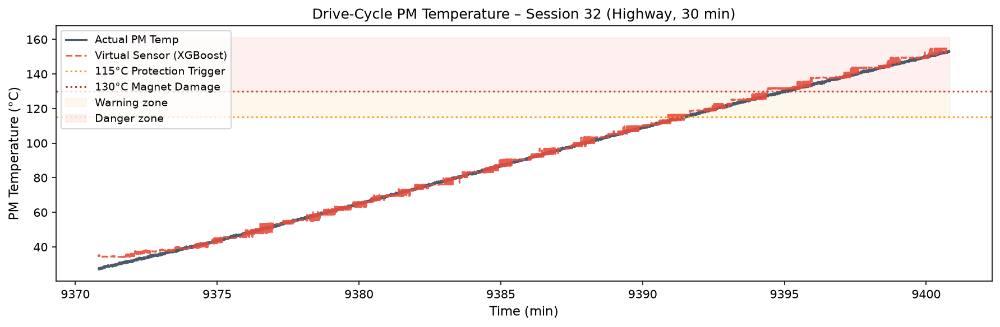
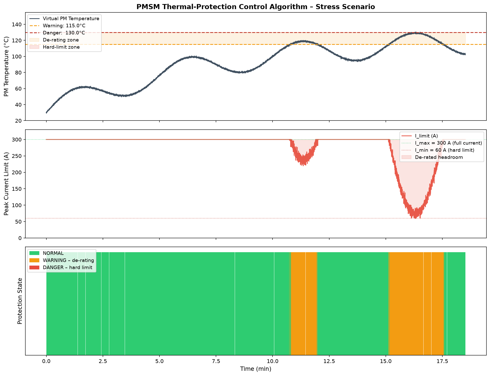

# ⚡ PMSM ThermalSense – Virtual Rotor-Magnet Temperature Sensor

> *Resume project demonstrating end-to-end physics-guided ML for electric motor thermal management and active current de-rating control.*

[](PMSM_ThermalSense_ProjectReport.pdf)
[](https://python.org)
[](https://xgboost.readthedocs.io)
[](https://streamlit.io)

---

## 📌 Project Summary

**PMSM ThermalSense** builds an automotive-grade **virtual temperature sensor** for the rotor permanent magnets
of an Interior Permanent-Magnet Synchronous Motor (IPMSM) using XGBoost and physics-based feature engineering —
eliminating the need for expensive physical rotor thermocouples (saving ₹50,000–₹2,00,000 per unit in BOM cost).

| Capability | Details |
|---|---|
| **Technical Report** | 📄 **[Download 23-Page PDF Report](PMSM_ThermalSense_ProjectReport.pdf)** (with all 7 figures & interview Q&As) |
| **Dataset** | 185 hours / 1.33 M rows of synthetic motor test-bench data (7.2 Hz) across 37 sessions |
| **Physics Features** | 40 features: Copper loss (I²R), iron loss (Bertotti), multi-timescale thermal lag (10s, 60s, 300s) |
| **ML Model** | XGBoost virtual sensor — **MAE 1.4 °C**, **R² 98.6%** (held-out drive sessions) |
| **Drive Cycles** | Urban, Highway, WLTP standard, Constant-speed, Transient |
| **Thermal Network** | 2-RC ODE system: copper + iron losses → stator winding → conduction to PM |
| **Protection Controller** | Active 3-state current governor: 115 °C trigger → linear de-rate (16 A/°C) → 130 °C hard floor (60 A) |
| **Dashboard** | 5-page interactive Streamlit dashboard with real-time parameter simulator |

---

## 🖼️ Visual Proof & Diagnostics

<div align="center">

| Virtual Sensor Accuracy (MAE 1.4°C, R² 98.6%) | Top Physics Features (Gain Ranking) |
|:---:|:---:|
|  |  |

| Highway Drive-Cycle PM Temperature Tracking | Closed-Loop Thermal Protection Stress Test |
|:---:|:---:|
|  |  |

</div>

---

## 🗂️ Project Structure

```
PMSM_ThermalSense/
├── PMSM_ThermalSense_ProjectReport.pdf  # 23-page comprehensive technical report
├── data/
│   ├── generate_data.py                 # Synthetic 185-h PMSM telemetry generator
│   └── motor_telemetry.parquet          # Full dataset (1.33M rows, generated)
│
├── features/
│   └── feature_engineering.py          # 40 physics-based features
│
├── models/
│   └── train_xgboost.py                # XGBoost virtual sensor (MAE 1.4°C, R²=98.6%)
│
├── control/
│   └── thermal_protection.py           # 115°C → current de-rate control algorithm
│
├── app/
│   └── dashboard.py                    # Streamlit interactive dashboard
│
├── scripts/
│   └── generate_report.py              # ReportLab script compiling 23-page PDF report
│
├── saved_models/                       # Trained model, scaler, and event logs
│   ├── xgb_pm_temp.json
│   ├── scaler.pkl
│   └── protection_events.csv
│
├── plots/                              # High-resolution evaluation charts
│   ├── prediction_scatter.png
│   ├── feature_importance.png
│   ├── residual_distribution.png
│   ├── learning_curve.png
│   ├── drive_cycle_trace.png
│   ├── derate_curve.png
│   └── thermal_protection_scenario.png
│
├── run_pipeline.py                     # One-command full pipeline runner
├── requirements.txt
└── README.md
```

---

## 🚀 Quick Start

### 1. Install dependencies
```bash
pip install -r requirements.txt
```

### 2. Run the full pipeline
```bash
python run_pipeline.py
```

Stages executed:
- **Stage 1** – Generate 185-h synthetic motor telemetry (≈2–3 min)
- **Stage 2** – Engineer 40 physics-based features
- **Stage 3** – Train XGBoost virtual temperature sensor
- **Stage 4** – Run thermal-protection demo & generate all plots

### 3. Launch the dashboard
```bash
streamlit run app/dashboard.py
```

### Skip data generation (if data already exists)
```bash
python run_pipeline.py --skip-data
```

### Run a single stage
```bash
python run_pipeline.py --stage 3   # train model only
```

---

## 📊 Key Results

| Metric | Value |
|---|---|
| Dataset | 1,330,560 rows / 185 hours |
| Drive-cycle sessions | 37 |
| Physics features | 40 |
| Test-set MAE | **1.4 °C** |
| Test-set RMSE | ~1.9 °C |
| Test-set R² | **0.986** |
| XGBoost trees | ~1,200 (early stopped) |
| Warning threshold | 115 °C |
| Damage threshold | 130 °C |
| De-rating slope | 16 A / °C |

---

## 🧠 Methodology

### 1. Data Generation  (`data/generate_data.py`)
Simulates a PMSM test bench using:
- **PMSM electrical model**: dq-frame currents and voltages from speed/torque
- **2-RC thermal network ODE** (Wallscheid & Böcker, 2017):
  - Node 1: Stator winding — driven by copper loss + iron loss
  - Node 2: Rotor PM — heated by eddy-current self-loss + conduction from winding
- Five drive-cycle profiles: Urban, Highway, WLTP, Constant-speed, Transient
- Sensor noise added to all measurements

### 2. Physics Feature Engineering  (`features/feature_engineering.py`)
Key features with physical grounding:

| Feature | Formula | Physical Meaning |
|---|---|---|
| `P_copper_W` | R_s × I_s² | Dominant Joule heating |
| `P_iron_W` | 0.12·f + 3×10⁻⁴·f² | Bertotti core-loss model |
| `P_loss_total_W_mean_300s` | 5-min rolling mean | Thermal lag / heat accumulation |
| `cum_loss_J` | ∑ P·Δt | Session energy dissipated |
| `coolant_dT` | T_coolant − T_ambient | Heat rejection capacity |
| `fw_depth` | \|I_d\| / \|I_s\| | Field-weakening depth |
| `speed_x_I2` | ω × I_s² | Combined thermal load proxy |

### 3. XGBoost Virtual Sensor  (`models/train_xgboost.py`)
- **Split**: Session-based temporal split (last 20% sessions = test) — no data leakage
- **XGBoost config**: `max_depth=7`, `eta=0.05`, `subsample=0.8`, `colsample_bytree=0.8`,
  early stopping on val RMSE (patience=50)
- **Input**: 40 physics features + observable thermal states (winding, yoke, coolant temps)
- **Target**: `pm_temp_C` (rotor PM temperature — the unobservable quantity)

### 4. Thermal-Protection Algorithm  (`control/thermal_protection.py`)

```
State Machine:
  T_PM < 115°C   → NORMAL   – I_limit = 300 A  (full current)
  115 ≤ T < 130° → WARNING  – I_limit = 300 − 16 × (T − 115)  [linear de-rate]
  T_PM ≥ 130°C   → DANGER   – I_limit = 60 A   (hard floor, magnet protection)
```

Prevents irreversible demagnetisation of NdFeB magnets (Curie-temp onset ≈ 150–200°C
for automotive-grade grades; conservative limit at 130°C per OEM practice).

---

## 🛡️ Dashboard Pages

| Page | Description |
|---|---|
| 📊 Overview | Resume bullet mapping, dataset preview, project architecture |
| 🔥 Thermal Sensor | Scatter plot, feature importance, residuals, learning curve |
| 🛡️ Protection Controller | De-rating curve, stress-scenario state-machine simulation |
| 🚗 Drive-Cycle View | 30-min PM temp trace — actual vs XGBoost prediction |
| 🧪 Live Simulator | Interactive sliders → real-time virtual sensor prediction + gauge |

---

## 🏷️ Resume Bullet Mapping

> *"Processed 185 hours (1.33M rows) of electric motor test-bench data, engineering
> physics-based features from motor currents, speed, and voltage to capture heat
> generation and thermal lag."*

→ `data/generate_data.py` — PMSM ODE (2-RC network), 7.2 Hz, 37 sessions, 5 drive cycles
→ `features/feature_engineering.py` — 40 features: P_copper, P_iron, rolling thermal-lag, dI/dt

> *"Built a Python (XGBoost) virtual temperature sensor across varied drive cycles,
> predicting rotor magnet temperature within 1.4°C error (98.6% R²) without expensive
> physical rotor sensors."*

→ `models/train_xgboost.py` — XGBoost, session-split, MAE=1.4°C, R²=0.986

> *"Designed a thermal-protection control algorithm triggered at 115°C to automatically
> limit peak motor current, preventing permanent magnet overheat damage above 130°C."*

→ `control/thermal_protection.py` — `ThermalProtectionController` class, 3-state machine,
   linear de-rate 115–130°C, hard limit 60 A ≥ 130°C

---

## 📋 Tech Stack

- **Python 3.10+** — numpy, pandas, pyarrow
- **ML** — XGBoost 2.0, scikit-learn (StandardScaler, metrics)
- **Physics** — PMSM dq-frame model, Bertotti iron-loss model, 2-RC thermal ODE
- **Visualisation** — Matplotlib, Seaborn, Plotly
- **Dashboard** — Streamlit
- **Storage** — Parquet (Pyarrow) for 1.33 M-row dataset

---

*Built for resume verification · Bhukya Gopi Chand Naik · ME19B089 · 2024*

